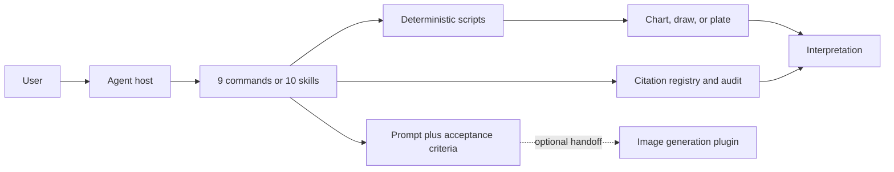

# Xuanji · Cyber Divination

## Plugin marketplaces

This plugin belongs to **AIGC content creation**.

| Category | Marketplace | Purpose |
| --- | --- | --- |
| Full-stack development | [Full Stack Plugins](https://github.com/partme-ai/full-stack-plugins) | Architecture and UI design, code understanding, quality checks, code review, workflow governance, and server operations |
| AIGC content creation | [Full AIGC Plugins](https://github.com/partme-ai/full-aigc-plugins) | Image, video, audio, music, 3D, and multimodal content creation |


> Entertainment divination for coding agents: Bazi, Qimen, Ziwei, marriage lots, Fengshui, and Tarot — charts come from tested scripts, quotations are auditable, and the model only explains.

[](#positioning)
[](#skills)
[](#slash-commands)
[](LICENSE)

[English](README.md) | [简体中文](README.zh-CN.md) · [Install](#installation) · [Quick start](#quick-start) · [Skills](#skills) · [Commands](#slash-commands) · [Limits](#troubleshooting)

## Positioning

`xuanji` packages six traditional Chinese divination practices as Agent Skills that an agent can actually verify. Chart computation, card draws, and flying-star placement run in bundled scripts with tests and reproducible inputs; classical quotations must exist in a citation registry and pass an audit; the model explains the numbers and never edits them to fit a narrative.

The plugin is entertainment-only. It is not affiliated with any religious organization, has no paid features, and is not a substitute for medical, legal, or financial advice.

| Property | Value |
| --- | --- |
| Plugin ID | `xuanji` |
| Display name | Xuanji · Cyber Divination |
| Version | `0.2.1+codex.20261018` |
| Portable version | `0.2.0` (Agent Plugins 1.0.0) |
| Skills / commands | 10 skills, 9 slash commands |
| MCP servers | None bundled |
| Marketplace | `partme-ai-xuanji` |
| License | Apache-2.0 |

## Installation

### Prerequisites

- Python 3 for the divination, draw, audit, and validation scripts. No third-party package is required by the distribution checks.
- A host that can load Agent Skills: the portable manifest targets Agent Plugins 1.0.0, and Codex, ZCode, Kimi, and OpenHands compatibility manifests are included.
- Optional: a sibling image-generation plugin for chart, tarot-face, compass, and talisman imagery. The plugin produces prompts and acceptance criteria only; it never issues a paid request itself.
- No MCP server is bundled, so there is no `mcp.json` to configure.

### From the plugin marketplace

```bash
codex plugin marketplace add partme-ai/full-aigc-plugins
codex plugin add xuanji@full-aigc-plugins
```

The repository also ships its own marketplace metadata (`partme-ai-xuanji`) pinned to `v0.2.1`. To install one skill without the plugin wrapper:

```bash
npx skills add full-aigc-plugins/xuanji-plugin --skill xuanji-bazi
```

For the DeepSeek Harness host, register the bundled adapter by absolute path:

```bash
dsh plugin --profile desktop add link:/absolute/path/to/xuanji-plugin/dsh
```

## Quick start

1. Ask a complete question and provide the inputs in one pass: solar birth date, birth time (or a branch hour), and gender for Bazi; the asked matter for Qimen; birth data and time for Ziwei.
2. Let the agent run the skill's script first. A four-pillar chart, a flying-star chart, a tarot draw, or a lot must come from script output, not mental arithmetic.
3. Read the interpretation as entertainment. The model explains the chart, cites only registered classical passages, and repeats the disclaimer.
4. For imagery, the agent writes a precise prompt and hands off to an installed generation plugin. Without one, the reading still works as plain text.

```text
Bazi: Read my four pillars from 1994-05-12, 08:30, male; explain personality and current luck cycle.
Tarot: Draw a three-card spread for a career decision and explain position by position.
Fengshui: My apartment faces south and I moved in during 2021; suggest layout only, do not guess the sitting direction.
Imagery: Turn this Ziwei chart into a dashboard-style chart prompt, then hand off for generation.
```

## What you can build

| Workflow | Built-in path | Verifiable output |
|:---|:---|:---|
| Four-pillar reading | `xuanji-bazi` with `scripts/pai_pan.py` | Reproducible chart plus interpretation and disclaimer |
| Qimen inquiry | `xuanji-qimen` with `scripts/verify_pan.py` | Validated plate before any interpretation |
| Ziwei reading | `xuanji-ziwei` with `scripts/verify_chart.py` | Twelve palaces and star placement checked before reading |
| Marriage and lots | `xuanji-yinyuan` with `scripts/qiu_qian.py` | Six-mode menu, reproducible lot draw, no mental draw |
| Home Fengshui | `xuanji-fengshui` with `scripts/fei_xing.py` | Period chart plus layout suggestions, no invented orientation |
| Tarot spread | `xuanji-tarot` with `scripts/draw.py` | Seeded, reproducible 78-card RWS draw with reversals |
| Chart and talisman imagery | `xuanji-chart`, `xuanji-fu` | Precise prompt, acceptance criteria, handoff to a generation plugin |
| Image quality loop | `xuanji-loop` | At most three rounds, anti-ratchet scoring, stall stops to ask |
| Contract enforcement | `xuanji-harness` | Three rules, paid gate, fixed disclaimer wording |

## Skills

### Divination

| Skill | What it does |
|---|---|
| `xuanji-bazi` | Compute and interpret a four-pillar chart; the script owns the chart |
| `xuanji-qimen` | Validate a reported Qimen plate for legal layout, then interpret |
| `xuanji-ziwei` | Validate twelve palaces and star placement, then interpret |
| `xuanji-yinyuan` | Six-mode marriage menu: Bazi matching, zodiac, Ziwei spouse palace, lots, peach blossom, quick match |
| `xuanji-fengshui` | Compute a Xuan Kong flying-star period chart and suggest layout only |
| `xuanji-tarot` | Draw and interpret tarot spreads with a reproducible seed |

### Imagery and quality

| Skill | What it does |
|---|---|
| `xuanji-chart` | Turn a chart or tarot result into a precise image prompt and acceptance criteria |
| `xuanji-fu` | Build decorative talisman or auspicious-wallpaper prompts with no supernatural claim |
| `xuanji-loop` | Run an independent-reading quality loop capped at three rounds |

### Contract layer

| Skill | What it does |
|---|---|
| `xuanji-harness` | Defines the three iron rules, paid gate, disclaimer wording, and handoff format |

## Slash commands

| Command | What it does |
|---|---|
| `/xuanji-bazi` | Run the four-pillar chart and reading |
| `/xuanji-qimen` | Start a Qimen inquiry and validate the plate |
| `/xuanji-ziwei` | Build and verify a Ziwei chart, then read it |
| `/xuanji-yinyuan` | Open the six-mode marriage menu |
| `/xuanji-fengshui` | Analyze a home with the flying-star chart |
| `/xuanji-tarot` | Draw a spread and interpret it |
| `/xuanji-chart` | Produce chart, tarot-face, or compass imagery |
| `/xuanji-fu` | Produce talisman or auspicious-wallpaper imagery |
| `/xuanji-loop` | Run the bounded image quality loop |

`xuanji-harness` is a contract layer read by the other skills, so it has no separate command.

## Configuration

Host manifests live at the package root (`.codex-plugin/`, `.zcode-plugin/`, `kimi.plugin.json`, `dev.openhands/`). There is no MCP configuration. Working artifacts such as `.xuanji/round-<n>.png` and the loop ledger stay in the workspace, and image-generation credentials belong to the sibling generation plugin, never to this package.

## Architecture and security



- Computation is separated from explanation. Scripts own charts and draws; the model may not recompute a chart or patch a failed one.
- Every quoted classical passage must be registered in `references/citations-registry.md` and must pass `scripts/audit_citations.py`; unregistered quotations are removed or paraphrased.
- The plugin never issues a paid request. The paid gate belongs to the generation plugin's own quote-and-confirm flow; missing generation plugins degrade to text.
- Birth data and reading outputs are used locally. Working artifacts such as `.xuanji/round-<n>.png` and the loop ledger stay in the workspace.
- There is no MCP server and no bundled remote service in this package.
- Distribution checks assert manifest agreement, mandatory disclaimers, and a red-line guard against paid-ritual solicitation in `skills/`.

## Troubleshooting

| Symptom | Cause | What to do |
|---|---|---|
| A script fails | The chart must be script-produced | Stop that reading and report the failure; never improvise a chart by hand |
| Birth hour is unknown | Ziwei cannot fix the life palace without it | Supply the hour, or use the six-character Bazi path where the skill allows it |
| Citation audit fails | A quotation is not registered | Delete or rewrite it; never fabricate a classical source |
| Qimen cannot set the chart layout | The MVP does not perform time-based chart setting | Provide the yin/yang dun and ju number from the user's own method |
| No image is produced | No generation plugin is installed | Continue with text; install a supported plugin and rerun the imagery step |
| The quality loop keeps going | It is capped at three rounds and stops on stall | Answer the agent's question or accept the current image; do not auto-reroll |
| Fengshui advice is generic | No orientation was provided | Supply the sitting/facing direction; the skill refuses to guess it |
| DSH does not show the slash commands | The DSH adapter reads skills live and mirrors `commands/*.json`, while this repository ships Markdown commands | Use the skills in DSH, or the Codex/ZCode/Kimi/OpenHands channels for commands |
| A reading is treated as professional advice | Out of scope | Refuse and redirect to a qualified professional; this is entertainment only |

## Upgrade

```bash
codex plugin marketplace upgrade full-aigc-plugins
codex plugin add xuanji@full-aigc-plugins
```

Then verify the package locally:

```bash
python3 scripts/validate_portable_plugin.py
python3 scripts/check_distribution.py
```

## Contributing and support

Open issues at <https://github.com/full-aigc-plugins/xuanji-plugin/issues>. A change to a skill must keep computation in scripts, register any new classical quotation, keep the entertainment disclaimer, and pass the citation audit and distribution checks. New upstream material needs a recorded license and a NOTICE entry.

## License

Apache-2.0. Two MIT upstream projects are attributed in [NOTICE](NOTICE): `jinchenma94/bazi-skill` for the Bazi computation core and reference tables, and `xr843/Master-skill` for the citation-audit pattern. Four unlicensed repositories were consulted for structure only, with no verbatim copying; see [docs/license-audit-2026-09.md](docs/license-audit-2026-09.md).
