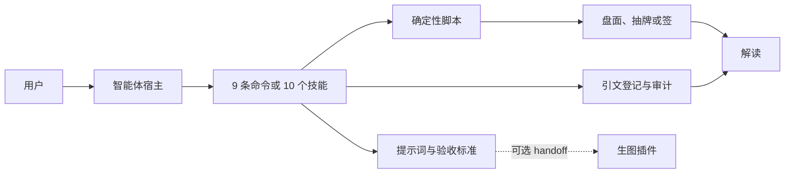

# 玄机 · 赛博玄学

## 插件市场导航

本插件所属分类：**AIGC 内容创作**。

| 分类 | 插件市场入口 | 用途 |
| --- | --- | --- |
| 全栈开发 | [Full Stack Plugins](https://github.com/partme-ai/full-stack-plugins) | 架构与 UI 设计、代码理解、质量检查、代码审查、流程治理与服务器运维 |
| AIGC 内容创作 | [Full AIGC Plugins](https://github.com/partme-ai/full-aigc-plugins) | 图像、视频、音频、音乐、3D 与多模态内容创作 |


> 给编码智能体的娱乐向玄学：八字、奇门、紫微、姻缘、风水、塔罗——排盘归脚本，引文可审计，模型只负责解释。

[](#项目定位)
[](#技能)
[](#斜杠命令)
[](LICENSE)

[English](README.md) | [简体中文](README.zh-CN.md) · [安装](#安装) · [快速开始](#快速开始) · [技能](#技能) · [斜杠命令](#斜杠命令) · [限制](#故障排查)

## 项目定位

`xuanji` 把六科传统术数做成智能体可以真正核验的 Agent Skills。排盘、抽牌与飞星全部由自带测试、同输入同输出的脚本完成；古籍原文必须登记在引文表里并跑过审计；模型只解释脚本给出的数字，绝不为了圆说法去改盘面。

本插件仅供娱乐，与任何宗教组织无关，没有任何付费项目，也不构成医疗、法律或投资建议。

| 属性 | 值 |
| --- | --- |
| 插件 ID | `xuanji` |
| 展示名 | Xuanji · Cyber Divination |
| 版本 | `0.2.1+codex.20261018` |
| Portable 版本 | `0.2.0`（Agent Plugins 1.0.0） |
| 技能 / 命令 | 10 个技能，9 条斜杠命令 |
| MCP 服务器 | 不内置 |
| 市场名 | `partme-ai-xuanji` |
| 许可证 | Apache-2.0 |

## 安装

### 前置条件

- 排盘、抽签、引文审计与分发校验脚本需要 Python 3；分发检查不依赖第三方包。
- 宿主需能加载 Agent Skills：portable 清单面向 Agent Plugins 1.0.0，同时附有 Codex、ZCode、Kimi 与 OpenHands 的兼容清单。
- 命盘图、塔罗牌面、罗盘与符箓成象需要另装生态里的生图插件。本插件只产出提示词与验收标准，自身不发起任何付费请求。
- 本包不内置 MCP 服务器，因此没有 `mcp.json` 需要配置。

### 从插件市场安装

```bash
codex plugin marketplace add partme-ai/full-aigc-plugins
codex plugin add xuanji@full-aigc-plugins
```

仓库本身也带市场元数据（`partme-ai-xuanji`），固定到 `v0.2.1`。如果只想装单个技能、不要插件外壳：

```bash
npx skills add full-aigc-plugins/xuanji-plugin --skill xuanji-bazi
```

DeepSeek Harness 宿主按绝对路径登记自带适配层：

```bash
dsh plugin --profile desktop add link:/absolute/path/to/xuanji-plugin/dsh
```

## 快速开始

1. 一次把问题与材料说全：八字要给阳历生日、出生时辰（或地支）与性别；奇门要说清所问之事；紫微要给生日与时辰。
2. 先让智能体跑技能脚本。四柱、飞星、抽牌、求签都必须来自脚本输出，不能口算。
3. 把解读当娱乐内容看。模型只解释盘面，只引用已登记的古籍原文，并附上免责声明。
4. 需要成象时，智能体写出精确提示词，再交给已安装的生图插件。没有生图插件也不影响纯文本解读。

```text
八字：1994-05-12 08:30 男，排四柱并解释性格与当前大运。
塔罗：就一次职业选择抽三张牌，按位置逐张解释。
风水：住宅朝南、2021 年入住，只给布局建议，不要猜坐向。
成象：把这张紫微盘转成仪表盘式命盘图的提示词，再交给生图插件。
```

## 可完成的工作

| 工作流 | 内置路径 | 可验证输出 |
|:---|:---|:---|
| 四柱八字 | `xuanji-bazi` 配合 `scripts/pai_pan.py` | 可复现的盘面、解读与免责声明 |
| 奇门问测 | `xuanji-qimen` 配合 `scripts/verify_pan.py` | 校验通过的盘面，之后才进入解读 |
| 紫微斗数 | `xuanji-ziwei` 配合 `scripts/verify_chart.py` | 十二宫与星曜落宫核对后的解读 |
| 姻缘与求签 | `xuanji-yinyuan` 配合 `scripts/qiu_qian.py` | 六模式菜单、可复现的签，不口算 |
| 阳宅风水 | `xuanji-fengshui` 配合 `scripts/fei_xing.py` | 运盘与布局建议，不猜坐向 |
| 塔罗牌阵 | `xuanji-tarot` 配合 `scripts/draw.py` | 可带种子复现的 78 张 RWS 正逆位抽牌 |
| 命盘与符箓成象 | `xuanji-chart`、`xuanji-fu` | 精确提示词、验收标准与跨插件交接 |
| 成象质量环 | `xuanji-loop` | 最多三轮、反棘轮评分、stall 即停下问人 |
| 契约约束 | `xuanji-harness` | 三铁律、付费门禁、固定免责口径 |

## 技能

### 术数解读

| 技能 | 作用 |
|---|---|
| `xuanji-bazi` | 排四柱八字并解读，盘面以脚本为准 |
| `xuanji-qimen` | 校验所报奇门盘的排布合法性，再作解读 |
| `xuanji-ziwei` | 校验十二宫与星曜落宫，再作解读 |
| `xuanji-yinyuan` | 六模式姻缘菜单：八字合婚、生肖、紫微夫妻宫、求签、桃花、速配 |
| `xuanji-fengshui` | 排玄空飞星运盘，只给整洁、采光、收纳级别的布局建议 |
| `xuanji-tarot` | 用可复现种子抽塔罗牌阵并解读 |

### 成象与质量

| 技能 | 作用 |
|---|---|
| `xuanji-chart` | 把盘面或牌阵结果转成精确提示词与验收标准 |
| `xuanji-fu` | 构造装饰性符箓或开运壁纸提示词，不宣称任何效力 |
| `xuanji-loop` | 跑独立解象的质量环，最多三轮 |

### 契约层

| 技能 | 作用 |
|---|---|
| `xuanji-harness` | 定义三铁律、付费门禁、免责话术与跨插件 handoff 格式 |

## 斜杠命令

| 命令 | 作用 |
|---|---|
| `/xuanji-bazi` | 排四柱并解读 |
| `/xuanji-qimen` | 起局问测并校验盘面 |
| `/xuanji-ziwei` | 排紫微盘、校验后解读 |
| `/xuanji-yinyuan` | 打开六模式姻缘菜单 |
| `/xuanji-fengshui` | 用飞星盘分析阳宅 |
| `/xuanji-tarot` | 抽牌阵并解读 |
| `/xuanji-chart` | 生成命盘图、牌面或罗盘成象 |
| `/xuanji-fu` | 生成符箓或开运壁纸成象 |
| `/xuanji-loop` | 执行有上限的成象质量环 |

`xuanji-harness` 是被其他技能读取的契约层，因此不单独提供命令。

## 配置

宿主清单都在包根目录（`.codex-plugin/`、`.zcode-plugin/`、`kimi.plugin.json`、`dev.openhands/`）。本包没有 MCP 配置。`.xuanji/round-<n>.png` 与循环账本等工作产物留在工作区；生图凭据属于生态里的生图插件，不由本包持有。

## 架构与安全



- 计算与解释分离。脚本负责盘面与抽牌；模型不得重算盘面，也不得在脚本失败时口头补盘。
- 每条古籍直引都必须登记在 `references/citations-registry.md`，并通过 `scripts/audit_citations.py`；未登记的引文删除或改写成转述。
- 插件本身不发起付费请求。付费门禁属于生图插件的报价确认流程；没有生图插件时降级为纯文本。
- 生日与解读产物在本地使用。`.xuanji/round-<n>.png` 与循环账本等工作文件留在工作区。
- 本包没有 MCP 服务器，也没有内置远端服务。
- 分发检查会核对清单一致性、强制免责声明，并扫描 `skills/` 中是否存在付费法事招揽等红线词。

## 故障排查

| 现象 | 原因 | 处理 |
|---|---|---|
| 脚本执行失败 | 盘面必须由脚本产出 | 终止该科解读并如实报告，绝不口算补盘 |
| 不知道出生时辰 | 紫微缺时辰无法定命宫 | 补齐时辰；或在技能允许时走六字八字路径 |
| 引文审计不通过 | 引文未登记 | 删除或改写，严禁伪托典籍 |
| 奇门定不了局 | MVP 不做时家定局 | 由用户按其流派给出阴阳遁与局数 |
| 没有生成图片 | 未安装生图插件 | 先用纯文本；安装受支持的插件后重跑成象步骤 |
| 质量环停不下来 | 最多三轮，stall 即停 | 回答智能体的问题或接受当前图；不要自动重摇 |
| 风水建议很泛 | 没有提供朝向 | 补坐向；技能不会替用户猜 |
| DSH 里看不到斜杠命令 | DSH 适配层实时读 `skills/`，只镜像 `commands/*.json`，而本仓命令是 Markdown | DSH 里用技能；命令走 Codex/ZCode/Kimi/OpenHands 通道 |
| 把解读当成专业意见 | 超出范围 | 拒绝并建议咨询专业人士；本插件仅供娱乐 |

## 升级

```bash
codex plugin marketplace upgrade full-aigc-plugins
codex plugin add xuanji@full-aigc-plugins
```

升级后在本地复核：

```bash
python3 scripts/validate_portable_plugin.py
python3 scripts/check_distribution.py
```

## 贡献与支持

问题请提交到 <https://github.com/full-aigc-plugins/xuanji-plugin/issues>。修改技能时必须保持计算在脚本里、为新引文登记出处、保留娱乐免责声明，并通过引文审计与分发检查。引入新的上游素材必须有可查许可证，并在 NOTICE 中登记。

## 许可证

Apache-2.0。两个 MIT 上游项目已在 [NOTICE](NOTICE) 中归属：`jinchenma94/bazi-skill` 提供八字排盘核心与参考表，`xr843/Master-skill` 启发引文审计模式。另有四个无许可证仓库仅参考结构与做法，零逐字搬运；见 [docs/license-audit-2026-09.md](docs/license-audit-2026-09.md)。
